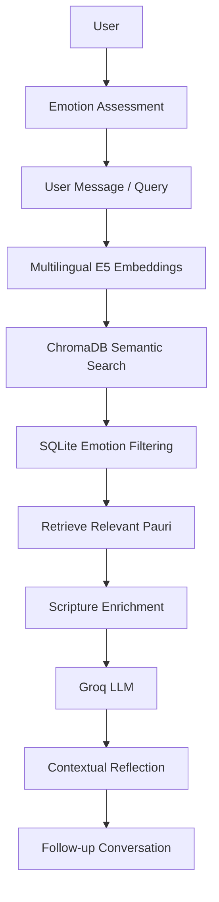

# CogniContext – Japji Sahib RAG Application

<p align="center">
  <strong>Find clarity through Gurbani.</strong>
</p>

<p align="center">
  An AI-powered emotional reflection application that connects a user's emotional state with the wisdom of Japji Sahib using Retrieval-Augmented Generation (RAG).
</p>

---

## About the Project

**CogniContext** is an AI-powered reflection platform designed to help users explore their emotions and understand the teachings of Japji Sahib in a meaningful and accessible way.

The application begins with an emotional assessment to understand how a user is feeling. Based on their responses, the system retrieves a relevant passage (Pauri) from Japji Sahib using semantic search and emotion-based filtering.

The retrieved passage is then passed to a Large Language Model (LLM) through Groq to generate a contextual explanation and support a grounded conversation.

CogniContext aims to bring together **spiritual wisdom, emotional awareness, semantic retrieval, and conversational AI**.

## Key Features

- **Emotion-Based Assessment:** A short assessment to understand the user's current emotional state and energy level.
- **Emotion-Aware Retrieval:** Retrieves relevant Japji Sahib passages based on emotional categories.
- **Semantic Search:** Uses multilingual embeddings and ChromaDB for similarity-based retrieval.
- **Japji Sahib Reader:** Displays original Gurmukhi text, transliteration, and English translations.
- **AI-Powered Reflection:** Uses Groq to generate contextual responses grounded in retrieved scripture.
- **Contextual Conversations:** Maintains conversation history and keeps the initially selected passage as context during follow-up questions.
- **Scripture Exploration:** Provides access to Japji Sahib Pauris and the concluding Salok.

## How It Works

CogniContext follows a Retrieval-Augmented Generation (RAG) workflow.

1. **Emotional Assessment:** The user completes a short assessment or expresses how they are feeling.
2. **Query Processing:** The user's message is prepared for semantic retrieval.
3. **Embedding Generation:** The multilingual E5 model converts the query into a vector representation.
4. **Semantic Retrieval:** ChromaDB searches for relevant Japji Sahib passages using cosine similarity.
5. **Emotion Filtering:** SQLite emotion mappings can filter the retrieved passages according to the selected emotional category.
6. **Context Enrichment:** The selected passage is enriched with Gurmukhi text, transliteration, and English translation from SQLite.
7. **LLM Generation:** The retrieved English translation and conversation context are passed to Groq.
8. **Grounded Response:** The generated explanation is returned to the user for reflection and follow-up conversation.

## System Architecture



## Technology Stack

| Category | Technologies |
|---|---|
| Frontend | HTML, CSS, JavaScript |
| Backend | Python, FastAPI |
| Vector Database | ChromaDB |
| Relational Database | SQLite |
| Embedding Model | intfloat/multilingual-e5-small |
| Large Language Model | Groq |
| Retrieval Method | Cosine Similarity |
| API Architecture | REST API |
| Testing | Pytest |

## Project Structure

```text
CogniContext/
│
├── backend/
│   ├── data/
│   │   ├── cognicontext.sqlite3
│   │   └── chroma_japji/
│   │
│   ├── data_templates/
│   ├── main.py
│   ├── groq_service.py
│   ├── vector_store.py
│   ├── japji_db.py
│   ├── local_db.py
│   ├── requirements.txt
│   └── .env.example
│
├── frontend/
│   ├── index.html
│   ├── app.js
│   └── styles.css
│
├── data_templates/
├── sql/
├── tests/
│
├── README.md
├── LOCAL_DATABASE_GUIDE.md
└── test_groq.py
```

## Getting Started

Follow these instructions to run CogniContext locally.

### 1. Clone the Repository

```bash
git clone https://github.com/Parneet184/CogniContext.git
cd CogniContext
```

### 2. Create a Virtual Environment

```bash
python -m venv .venv
```

Activate it on Windows PowerShell:

```powershell
.venv\Scripts\Activate.ps1
```

### 3. Install Dependencies

```bash
pip install -r backend/requirements.txt
```

### 4. Configure Environment Variables

Create your local environment file using the provided example:

```powershell
Copy-Item backend/.env.example backend/.env
```

Configure the required Groq API key and other environment settings according to the example file.

**Never commit your `.env` file or expose API keys in the repository.**

### 5. Start the Backend

From the project root:

```bash
uvicorn backend.main:app --reload --port 8001
```

Backend:

`http://127.0.0.1:8001`

API documentation:

`http://127.0.0.1:8001/docs`

### 6. Start the Frontend

Open a second terminal:

```powershell
cd frontend
python -m http.server 8000
```

Open:

`http://127.0.0.1:8000`

## API Endpoints

The FastAPI backend provides the following endpoints:

| Method | Endpoint | Description |
|---|---|---|
| GET | `/api/v1/health` | Backend and database health information |
| GET | `/api/v1/themes` | Available emotional themes |
| GET | `/api/v1/japji/pauris` | Retrieve Japji Sahib Pauris |
| GET | `/api/v1/japji/salok` | Retrieve concluding Salok |
| GET | `/api/v1/japji/pauris/{pauri_number}` | Retrieve a specific Pauri |
| POST | `/api/v1/japji/search` | Semantic scripture search |
| POST | `/api/v1/chat` | AI-powered contextual conversation |
| POST | `/api/v1/assess` | Emotion-based assessment and retrieval |

Interactive API documentation is available at `/docs` when the backend is running.

## Database and Retrieval

CogniContext uses two complementary storage systems:

**SQLite**
- Stores Japji